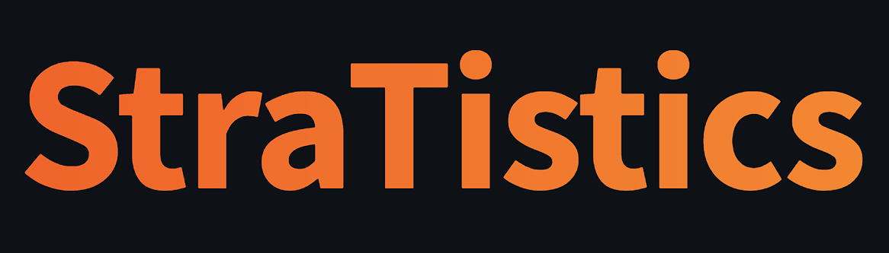
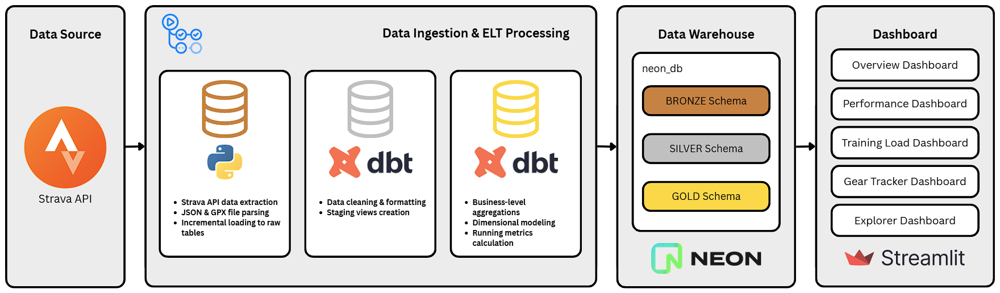
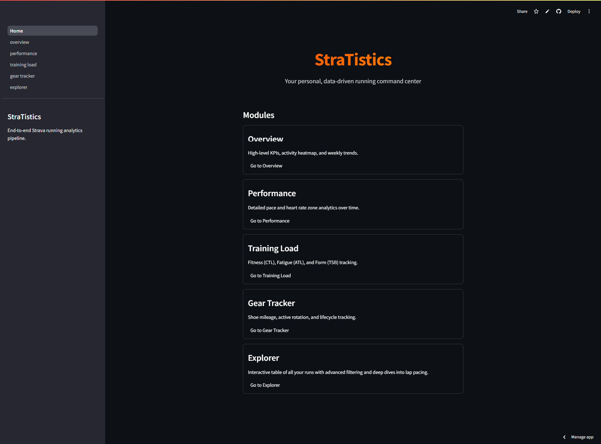
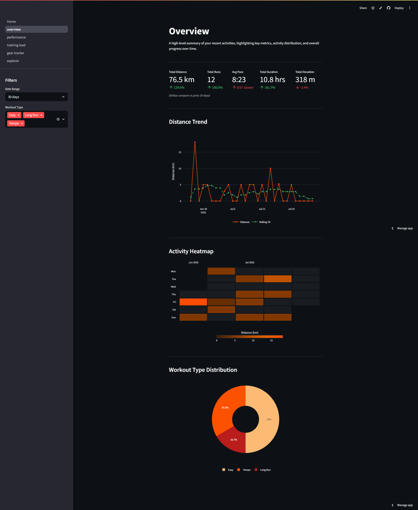
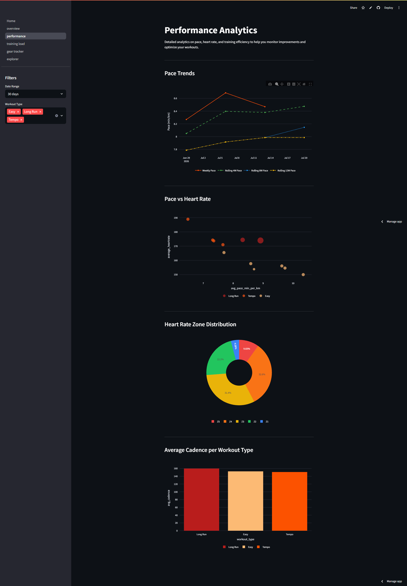
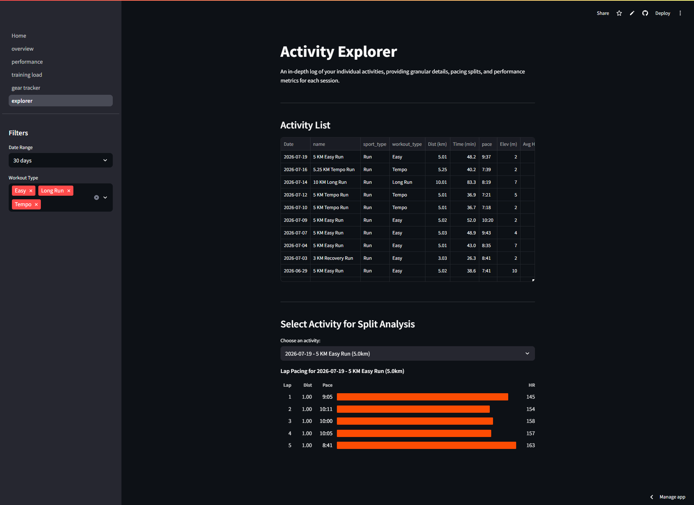

<p align="center">
  
</p>

> An end-to-end data engineering and analytics pipeline built to extract, load, transform, and analyze running data from Strava.

## Live Dashboard

Check out the live StraTistics Dashboard hosted on Streamlit:
**[Click here to view the live dashboard](https://stratistics.streamlit.app/)**


## Architecture & Data Flow

<p align="center">
  
</p>

The project follows a standard **Medallion Architecture** (Bronze, Silver, Gold) powered by a modern serverless data stack.

1. **Extraction & Loading (Ingestion - Bronze):** Custom Python scripts (`ingestion/`) interact with the Strava API to extract activity data (JSON). This raw data is loaded directly into a `bronze` schema in a serverless Neon DB (PostgreSQL).
2. **Orchestration:** GitHub Actions (`.github/workflows/`) manages the scheduling and execution of data pipelines via CRON jobs and manual triggers. This ensures reliable incremental syncs and historical backfills without needing any local infrastructure (like Airflow or Mage).
3. **Transformation (dbt - Silver & Gold):** `dbt` (data build tool) handles the SQL transformation logic. It cleans the raw bronze data into a `silver` staging layer (views), and finally aggregates it into `gold` marts and metrics (tables). This dimensional modeling prepares the data perfectly for BI and reporting.
4. **Data Quality Validation (Great Expectations):** Great Expectations (`quality/`) is integrated seamlessly into the pipeline. It ensures data integrity, validates pipeline outputs at every stage, and catches anomalies early.
5. **Visualization (Streamlit):** A custom Streamlit application (`dashboard/`) connects to the `gold` schema in Postgres to serve beautiful, interactive visualizations of your running performance over time.

## Tech Stack

* **Database / Data Warehouse:** [Neon DB](https://neon.tech/) (Serverless PostgreSQL)
* **Orchestration:** GitHub Actions
* **Transformation:** dbt (`dbt-postgres`)
* **Data Quality:** Great Expectations
* **Ingestion Scripts:** Python (`requests`, `pandas`, `gpxpy`, `psycopg2`)
* **Frontend / BI Dashboard:** [Streamlit](https://streamlit.io/) (`plotly` for interactive charts)


## Project Structure

```text
StraTistics/
├── .github/workflows/
│   ├── strava_backfill.yml         # GitHub Action for historical data load
│   └── strava_incremental_sync.yml # Daily CRON GitHub Action for new activities
├── dashboard/                      # Streamlit dashboard application
│   ├── Home.py                     # Main entrypoint for Streamlit app
│   ├── db.py                       # Database connection handling
│   ├── pages/                      # Additional Streamlit pages
│   ├── components/                 # Reusable UI components
│   └── styles/                     # CSS & custom styling
├── dbt_strava/                     # dbt transformation project
│   ├── dbt_project.yml             # Main dbt configuration
│   ├── profiles.yml                # Database connection profile for dbt
│   └── models/                     # SQL models (Bronze to Silver to Gold)
│       ├── staging/                # Silver layer: cleaning and standardizing
│       ├── marts/                  # Gold layer: dimension/fact tables
│       └── metrics/                # Aggregated metric tables
├── ingestion/                      # Python scripts for data extraction
│   ├── strava_auth.py              # Handles OAuth token refresh
│   ├── strava_api_client.py        # Core API interaction logic
│   ├── api_backfill.py             # Script for fetching historical data
│   ├── daily_ingest.py             # Script for fetching recent activities
│   └── load_to_postgres.py         # Logic for loading JSON/GPX to Neon DB
├── quality/                        # Great Expectations data validation
│   ├── expectations/               # Data quality rules and suites
│   ├── checkpoints/                # Checkpoint configurations
│   └── run_validations.py          # Script to execute data quality checks
├── requirements.txt                # Python dependencies
├── README.md                       # Project documentation
└── .env.example                    # Template for required environment variables
```

## Prerequisites

Before you begin, ensure you have the following setup:
1. A **[Neon DB](https://neon.tech/)** serverless PostgreSQL database instance.
2. A **Strava Developer Account**. You can create an application in your [Strava API Settings](https://www.strava.com/settings/api). You will need:
   - `Client ID`
   - `Client Secret`
   - `Refresh Token`

## Setup Instructions

This pipeline is designed to run entirely via GitHub Actions.

### 1. Configure GitHub Secrets
Navigate to your repository on GitHub -> **Settings** -> **Secrets and variables** -> **Actions** and add the following repository secrets based on the `.env.example` file:

* `POSTGRES_USER`
* `POSTGRES_PASSWORD`
* `POSTGRES_HOST`
* `STRAVA_CLIENT_ID`
* `STRAVA_CLIENT_SECRET`
* `STRAVA_REFRESH_TOKEN`

### 2. Local Setup (For Development & Dashboard)
If you want to run the Streamlit dashboard or run Python/dbt scripts locally:

```bash
# Clone the repository
git clone https://github.com/Emriqurrizal/StraTistics.git
cd StraTistics

# Create and activate a virtual environment
python -m venv venv
source venv/bin/activate  # On Windows use `venv\Scripts\activate`

# Install requirements
pip install -r requirements.txt

# Create a .env file based on the example
cp .env.example .env
# Fill in your .env file with your database and Strava credentials
```

## Running the Pipeline

The pipeline processes are fully automated via GitHub Actions, but here is how they function:

1. **Initialize the Data Warehouse:** The `bronze` schema and raw tables are automatically created on your database the first time the Python ingestion scripts run.
2. **Initial Load (Backfill):** Navigate to the **Actions** tab in your GitHub repository, select the **Strava Backfill** workflow, and click **Run workflow**. This extracts all your historical data from Strava and populates the `bronze` layer.
3. **Transformations (dbt):** The dbt models handle the transformation from `bronze` -> `silver` -> `gold`. These run automatically as part of the GitHub Action workflows immediately after ingestion.
4. **Incremental Sync:** The **Strava Incremental Sync** workflow is automatically scheduled to run daily at 2:00 AM UTC via GitHub Actions cron, fetching only newly completed activities.
5. **Data Quality Validation:** Great Expectations suites run automatically as a step in every GitHub Action workflow. If data fails validation, the workflow fails, alerting you to the anomaly.

## Running the Dashboard Locally

To run the Streamlit dashboard on your local machine to view the results from the `gold` tables:

```bash
cd dashboard
streamlit run Home.py
```
The application will be available at `http://localhost:8501`.

## Screenshots

<p align="center">
  
</p>
<p align="center">
  
</p>
<p align="center">
  
</p>
<p align="center">
  
</p>
<p align="center">
  
</p>
<p align="center">
  
</p>